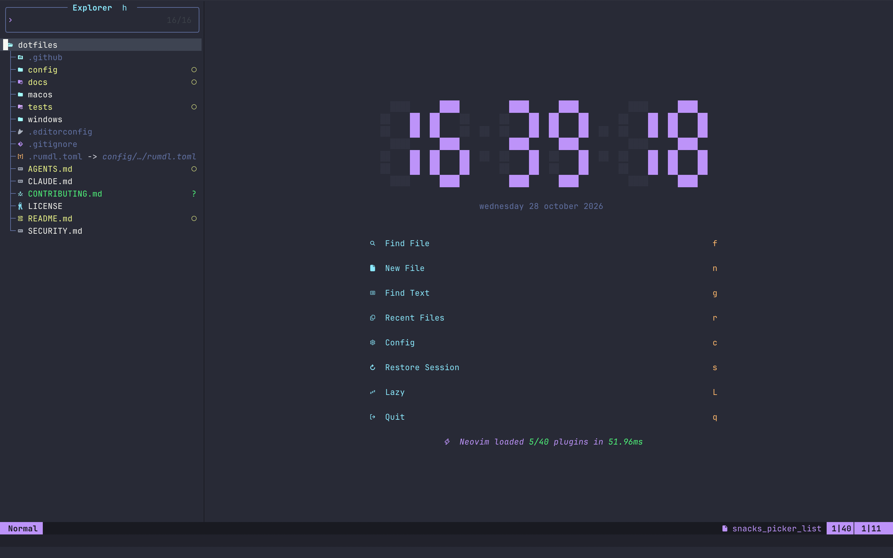

<h1 align="center">dotfiles</h1>

<p align="center">
  <b>One command turns a fresh Mac into a Neovim IDE for code, LaTeX, notes and code review,
  tested like a product.</b>
</p>

<p align="center">
  <a href="https://github.com/aguiar-arthur/dotfiles/actions/workflows/tests.yml"></a>
  
  
  
  <a href="LICENSE"></a>
</p>

<p align="center">
  
</p>

```sh
git clone https://github.com/aguiar-arthur/dotfiles.git ~/dotfiles && ~/dotfiles/macos/install.sh
```

## Why this one

| | |
|---|---|
| **Review changes in the editor** | your branch, any other, a pull request: side by side, nothing checked out, and on your own files `gd` and `K` work |
| **Claude Code, wired in** | it sees your files, selection and diagnostics, and proposes diffs you accept with a key |
| **Tested like software** | the checks drive a real Neovim in tmux: servers, debugger, a LaTeX build, a run on a fresh machine; every key is documented or a test fails |
| **Secure by default** | gitleaks, zizmor and ShellCheck on every push, actions pinned to a commit |
| **Never restyles other people's code** | format on save only where the project declares a style |
| **LaTeX in Skim** | `,ll` builds into `build/`, `,lt` and texlab move through the document, Cmd+Shift+click in the PDF jumps back |
| **Notes without an app** | plain Markdown, `[[links]]`, backlinks and daily notes, no Obsidian account |
| **Clojure in one key** | `,cj` starts the REPL and connects; results appear next to the code |
| **Built for AI assistants** | `AGENTS.md` and one doc per context, so an agent changes it without breaking it |
| **Idempotent, part by part** | run it again and it only does what is missing; install only Neovim on a borrowed Mac |
| **Small on purpose** | about 40 plugins, each well tested and maintained, pinned in a lockfile you can roll back |

## What you get

- **Neovim**: the editor for everything: code in 11 languages with their servers, run, test and
  debug, git and reviews, LaTeX, Markdown and notes, Claude Code.
- **Starship** prompt, **zsh**, **tmux** and an **iTerm2** profile, all in Dracula with
  JetBrains Mono Nerd Font.

Below: [install](#install), then [Neovim](#using-neovim), [LaTeX](#latex),
[Markdown and notes](#markdown-and-notes) and the [shell and terminal](#shell-prompt-and-terminal),
then [troubleshooting](#troubleshooting), [update](#update), [check](#check) and [test](#test).
How each part works inside, and why, is in
[docs/](docs), one file per context (listed in [AGENTS.md](AGENTS.md#context-map)), which is
also what an AI assistant reads before changing it.

## Install

On a Mac with macOS and an internet connection; nothing else is needed beforehand.

1. **Clone the repository.** On a new Mac, `git` asks to install the Command Line Tools
   first: accept, wait for it to finish, then run the command again.

   ```sh
   git clone https://github.com/aguiar-arthur/dotfiles.git ~/dotfiles
   ```

2. **Run the installer.** It takes a while the first time (MacTeX alone is several GB) and
   asks for your password when Homebrew and MacTeX install.

   ```sh
   cd ~/dotfiles && macos/install.sh
   ```

   It runs the four parts below one after the other, and a failed part does not stop the
   others. Each part goes through its steps (Homebrew and the part's `Brewfile`, `link.sh`, and
   for Neovim the plugins at the versions in `lazy-lock.json`, the Mason servers, the parsers and
   the Portuguese spell file); a failed step does not stop the next. It ends with `Done.` or
   `Failed: <parts>`; fix the errors printed above and run it (or just that part) again. Running
   it again only does what is missing.

3. **Quit iTerm2 (Cmd+Q) and open it again.** The new window uses the "Dotfiles (Dracula)"
   profile with JetBrains Mono Nerd Font, Homebrew on `PATH` and the Starship prompt. If the
   profile did not become the default, run `macos/terminal/link.sh` with iTerm2 closed.

4. **Open Neovim** (`nvim`) and run `:checkhealth` (see [Check](#check)).

### One part at a time

Neovim, terminal, tmux and apps install on their own, so a machine gets only what you want on it.

<details><summary>Details</summary>

| Part | Command | Installs and links |
|---|---|---|
| Neovim | `macos/nvim/install.sh` | Neovim, git, ripgrep, ast-grep, fd, tree-sitter, node, python, the formatters, pandoc, lazygit, gh, Clojure and its tools, MacTeX (no GUI), latexindent, Skim, Claude Code; `~/.config/nvim`, `~/.config/rumdl/rumdl.toml`, `~/.latexmkrc`, Skim's preferences; then the plugins, servers and parsers |
| Terminal | `macos/terminal/install.sh` | Starship, eza, fzf, iTerm2, JetBrains Mono Nerd Font; `~/.config/starship.toml`, the iTerm2 profile, `~/.config/git/`, the `~/.zshrc` block |
| tmux | `macos/tmux/install.sh` | tmux, lazygit; `~/.config/tmux/tmux.conf`, lazygit's Dracula `config.yml`; the whichkey-tmux plugin in `~/.config/tmux/plugins/` |
| Apps | `macos/apps/install.sh` | uv, ruby, mole, gitleaks, GrandPerspective |

On a machine whose shell and terminal are already set up and must stay as they are, run only
`macos/nvim/install.sh`, and `macos/tmux/install.sh` if you want tmux there too. Two things then
stay up to that machine: Homebrew on `PATH` (if Homebrew was just installed, it prints the line
to add) and a Nerd Font in the terminal for the icons. Running another part later adds it.

</details>

### What the `link.sh` files do

Each part's `link.sh` links its files into this repository, keeps what was there as
`<name>.bak.<timestamp>` (the iTerm2 profile's outside the folder iTerm2 loads), and adds one
marked block to `~/.zshrc`; the rest of `~/.zshrc` stays yours. It runs on its own after a
`git pull`. Details: [docs/install.md](docs/install.md).

## Using Neovim

`Space` is the leader key and `,` the local leader. `Space …` keys work in every file;
`, …` keys depend on the file type (run, test, debug, LaTeX, Clojure). Press either one and
wait: which-key lists every key that follows, so nothing has to be memorised.
`Space ?` lists the keys of the current buffer, and `Space f k` searches every key.

### First day

| Key | Does |
|---|---|
| `Space f f` / `Space f g` | find a file / search text in the project |
| `Space f r` / `Space b b` | recent files / open buffers |
| `Space o p` | file tree |
| `Space s` / `Space q` | save / quit |
| `gd` / `grr` / `K` | go to definition / references / documentation |
| `gra` / `grn` | code action / rename |
| `Space g g` | lazygit |
| `,r` | run the file (Python, Lua, shell, zsh, JavaScript, C, C++, Java, Ruby, Rust) |

### What is in it

- **Finding and moving**: one Snacks picker for files, text, symbols, git and more; flash,
  mini.ai and mini.surround to jump and edit by objects; grug-far to replace across the project,
  also by syntax; completion with blink.cmp (`Tab` walks a snippet's fields, `Enter` accepts).
- **Windows and terminals**: floating, bottom and side terminals that keep their history, and one
  session per folder, restored on start.
- **Code**: servers for Lua, Python, HTML, CSS, JSON, YAML, TOML, Bash, Markdown, LaTeX and
  Clojure. `,r` runs the file, `,t` runs tests (Neotest), `,d` debugs with a watch panel.
- **Git**: gitsigns in the margin, lazygit, and reviews in their own tab with the old and new
  versions side by side: your changes, a branch, a pull request, a commit, a file's or a line's
  history, nothing checked out. On your own file `gd`, `K` and edits work. `Space g n` lists the pull
  requests waiting on your review, `]u` goes to the next file you have not read, and `Ctrl-l` in
  `Space g P` shows only what changed since you last reviewed a pull request to the end. The file
  list checks the files you read and remembers them until their diff changes (`Space g x` hides
  them), each side says what it is, the function you are in and which hunk, unchanged code folds
  away, and `Space g H` jumps to any hunk of the review.
- **Claude Code**: a floating window that sees your files, selection and diagnostics and shows
  its edits as a diff to accept or reject. Log in once in the terminal first (`claude`, then
  `/login`).
- **Toggles and look**: `Space u` toggles spelling, wrap, diagnostics, format on save and more,
  each for every window. Dracula, a status line with the servers' progress, and no "Press ENTER"
  prompts (Neovim's `ui2`).

One behaviour to know:

- **Saving formats the file only in projects that declare that formatter's style** (a
  `stylua.toml`, `[tool.ruff]`, …), so other people's code is never restyled. Prettier runs a
  project's JavaScript, so it also needs a `.nvim.lua` approved with `:trust` next to its config.
  `Space l f` formats anywhere; `Space u f` turns format-on-save off.

### Clojure

Open a file of a `deps.edn`, `project.clj` or `bb.edn` (Babashka) project and press `,cj`: it
starts an nREPL in a terminal below and connects as soon as it is up (or only connects when a
REPL already runs). Results show next to the code; completion also offers what the REPL knows.

## LaTeX

A build on demand, the PDF in Skim at the cursor, and a click in the PDF back to the source.

1. Open the main file: `nvim main.tex`.
2. `,ll` starts the build (latexmk, continuous): from then on each save rebuilds the PDF, until
   `,ll` again or `,lk` stops it.
3. `,lv` opens the PDF in Skim at the line under the cursor. Skim stays in the background.
4. In Skim, **Cmd+Shift+click** jumps back to that line in Neovim.
5. `,le` lists errors and warnings; `Enter` on one goes to the line.

The PDF, the bibliography and the auxiliary files go to `build/` next to the main file. For
another engine, put `% !TEX program = lualatex` on the first line. A `latexmkrc` inside a project
wins over the linked `~/.latexmkrc`. Spelling is in English and Portuguese: `]s` / `[s` move
between misspelled words, `z=` suggests, `zg` accepts a word everywhere.

## Markdown and notes

`,p` builds an HTML preview with pandoc and opens it in the browser; every save rebuilds it.
`Space u m` turns the rendered view (headings, tables, checkboxes) on or off. rumdl underlines
problems as you type and reformats on save only in projects with a `.rumdl.toml` or
`.markdownlint.*`.

Notes are plain `.md` files in `~/notes` (change it with `notes.dir` in
[`local.lua`](#per-machine-settings)), handled by obsidian.nvim; no Obsidian app or account is
needed. `Space n n` creates a note, `Space n d` opens today's, `[[` links to another as you type
and `Space n b` lists the notes that link here.

## Shell, prompt and terminal

- **zsh**: `~/.zshrc` gets one marked block (`# >>> dotfiles >>>`) that sources
  `config/zsh/dotfiles.zsh`: Homebrew on `PATH`, Neovim as `EDITOR`, a shared 50,000-line history,
  Tab completion, the Starship prompt, emacs keys, and two helpers: `path_report` lists `PATH` in
  order and `command_origin <name>…` says which program runs and whether Homebrew installed it.
  Everything else in `~/.zshrc` stays yours.
- **fzf** searches as you type: `Ctrl-r` the history, `Ctrl-t` a file, `Alt-c` a folder. Alt is
  the left Option; the right one still types accents and symbols.
- **eza** lists files with icons: `ls`, `ll` (everything, with git status), `lt` (by date, newest
  last); `command ls` is the system's.
- **Starship**: folder, git, the project's language versions, how long the last command took and
  a failed command's status, as rounded pills in Dracula colors. A blank line separates prompts.
- **tmux** (its own part): a Dracula status bar, `Ctrl-h/j/k/l` across panes and Neovim's
  windows alike, lazygit and a scratch shell in popups, and
  [whichkey-tmux](https://github.com/aguiar-arthur/whichkey-tmux) showing the keys after the
  prefix. It works without the Neovim config; only leaving a Neovim pane with `Ctrl-h/j/k/l`
  needs it.
- **iTerm2**: the "Dotfiles (Dracula)" profile with JetBrains Mono Nerd Font, which the icons
  need. **latexmk** and **rumdl** have their own config in `config/` too.

## Troubleshooting

| Symptom | Fix |
|---|---|
| `git clone` asks for the Command Line Tools | accept, wait for them, run the command again |
| The brew step says `mactex-no-gui` conflicts with `basictex` | `brew uninstall --cask basictex`, then run `macos/nvim/install.sh` again |
| basedpyright or debugpy stop starting after `brew upgrade` | `macos/nvim/install.sh` reinstalls them for the new Python (the quick tests name them) |
| A plugin update broke something | `git restore config/nvim/lazy-lock.json`, then `:Lazy restore` |
| A Neovim update warns `ui2 is off` | delete the `ui2` lines in `config/nvim/lua/config/options.lua` |
| Icons show as boxes | the terminal needs a Nerd Font (the terminal part installs one) |
| iTerm2 did not switch to the Dracula profile | quit iTerm2, run `macos/terminal/link.sh`, open it again |
| `:checkhealth snacks` errors in `nvim --headless` | not real; check in a real Neovim window |

## On a machine that is not yours

Install only Neovim and leave nothing personal behind.

<details><summary>Details</summary>

Install the Neovim part only (`macos/nvim/install.sh`): it leaves the shell, the prompt and the
terminal untouched. Then:

- Do not put personal tokens or SSH keys there; log in with a short-lived, narrow token, or
  none, and run `gh auth logout` or delete it when you leave.
- Do not trust a `.nvim.lua` from a repository you did not write; `exrc` asks before running
  one, so answer no. clojure-lsp runs a project's build tool to read its classpath, so open
  Clojure files of repositories you did not write with care.
- Before running anything on a fresh clone, read `git log` for commits you do not recognise.
- When you leave, remove `~/.config/nvim`, `~/.local/share/nvim`, `~/.local/state/nvim` and
  `~/.cache/nvim`.

GitHub checks this repository on every push and every Monday: ShellCheck on the scripts,
gitleaks on the history and zizmor on the workflows.

</details>

## Update

Nothing updates itself: about once a month, on a branch, with the steps in
[docs/install.md](docs/install.md#updating).

## Check

Read-only commands that say what is missing or wrong.

<details><summary>Details</summary>

| What | How | All good when |
|---|---|---|
| Programs | `brew bundle check --no-upgrade --verbose --file ~/dotfiles/macos/<part>/Brewfile` (`nvim`, `terminal`, `tmux`, `apps`) | `The Brewfile's dependencies are satisfied.` |
| Links, `~/.zshrc`, app preferences | each part's `link.sh` (fix what differs) | every line starts with `ok` |
| Neovim starts cleanly | `nvim --headless "+qa"` | it prints nothing |
| Everything inside Neovim | `:checkhealth` | no `ERROR` |
| Language servers in this buffer | `:checkhealth vim.lsp` | the server is under "Active Clients" |
| Plugins / Mason | `:Lazy` / `:Mason` | nothing in red / all installed |
| Formatters for this buffer | `:ConformInfo` | the formatter shows as ready |
| Secrets in the history | `gitleaks git` | `no leaks found` |

Run `:checkhealth` in a real Neovim window: in `nvim --headless` the Snacks checks report
errors that are not real. When a check fails, `macos/install.sh` (or the part's) is the fix for
anything missing: it installs only what is not there.

</details>

## Test

`~/dotfiles/tests/nvim.sh` checks the setup in seconds; `tests/nvim.sh full` drives a real
Neovim in tmux (minutes), and `tests/nvim.sh fresh` does it as on a new machine. Run quick after
any change, full after changing plugins, keys or servers, fresh after changing `macos/`. How it
works: [docs/tests.md](docs/tests.md).

## Per-machine settings

`config/nvim/lua/config/local.lua` (untracked, read when present) returns a table merged
over `lua/config/settings.lua`, for example:

```lua
return { wrap = false, spelllang = { "en_us" }, notes = { dir = "~/Documents/notes" } }
```

For a single project, a `.nvim.lua` at its root ([docs/core.md](docs/core.md#per-project-settings)).

## Windows health report

Not part of the macOS setup: to find why a Windows 11 PC shuts down or crashes, run in
PowerShell as Administrator

```powershell
powershell -ExecutionPolicy Bypass -File .\windows\collect-diagnostics.ps1
```

It only reads, zips a report into `Documents\diagnostics`, and asks before any repair. The ZIP
holds computer and user names, serial numbers and crash dumps: read it before sharing. Its
options and what it collects are in [docs/windows.md](docs/windows.md).

## Layout

Where each file lives: [AGENTS.md](AGENTS.md#layout).

MIT, see [LICENSE](LICENSE).
